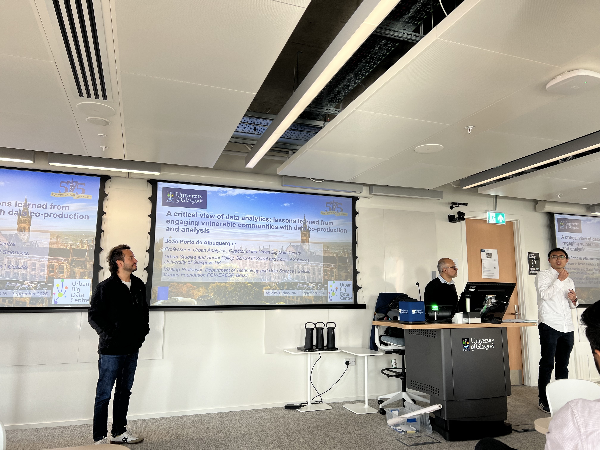
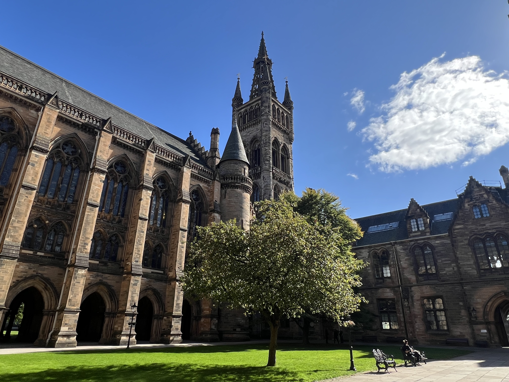
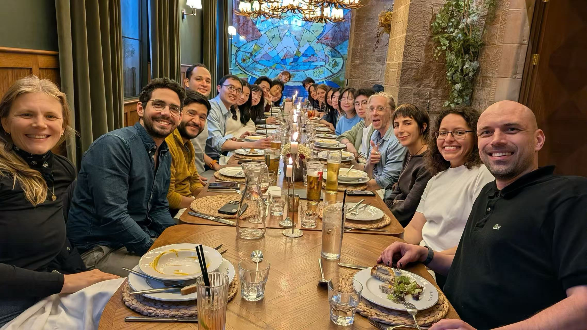
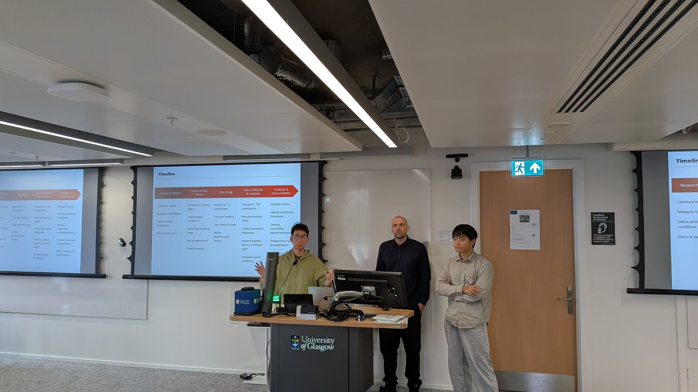

It was a pleasure to visit Glasgow for the first time and attend the AGILE PhD School 2026: 8th Edition – Urban Analytics in the AI Era!

<figure style="text-align: center;">
  
  <figcaption style="font-size: 0.85em; color: #666;">
    Opening session led by Prof. Qunshan Zhao and Prof. João Porto de Albuquerque.
  </figcaption>
</figure>

The PhD School offered a great opportunity to explore a variety of topics, including participatory GIS, mobility data, and street-view analysis. It was also fun to get hands-on experience with different sensors and learn about their applications in urban analytics.

<figure style="text-align: center;">
  
  <figcaption style="font-size: 0.85em; color: #666;">
    The beautiful campus of the University of Glasgow.
  </figcaption>
</figure>

<figure style="text-align: center;">
  
  <figcaption style="font-size: 0.85em; color: #666;">
    Conference banquet at a traditional venue.
  </figcaption>
</figure>

Another highlight was the opportunity to brainstorm a research proposal in teams over two and a half days and present our ideas in the final session. It was an intense but rewarding experience, with plenty of exciting research ideas emerging from our discussions. The constructive feedback from the professors also gave us valuable perspectives on how to further develop our proposal.

<figure style="text-align: center;">
  
  <figcaption style="font-size: 0.85em; color: #666;">
    Presenting our research proposal.
  </figcaption>
</figure>

Many thanks to the organisers, instructors, and fellow PhD students for making this such an enjoyable experience!