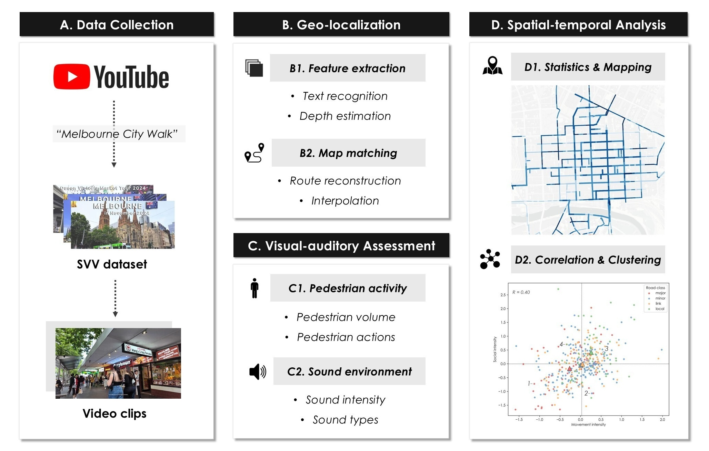
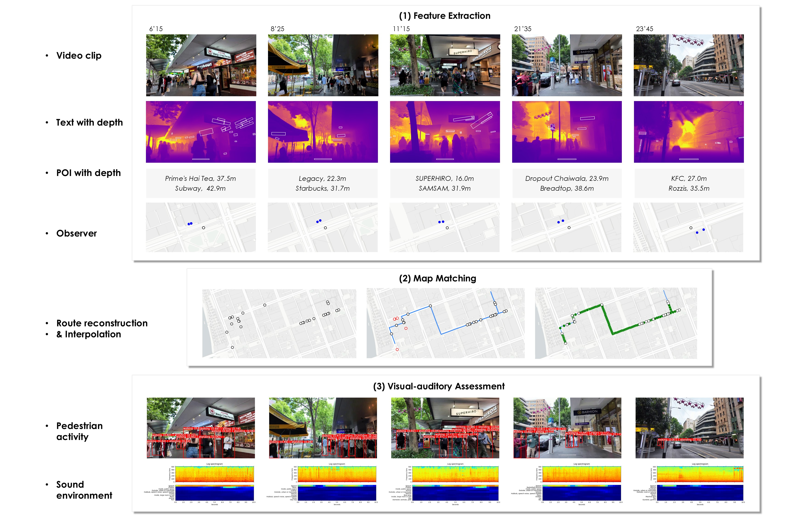
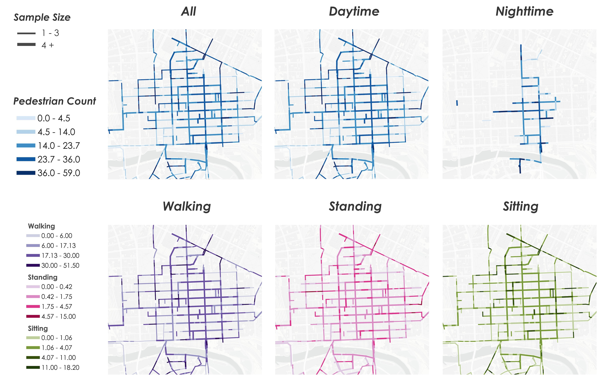
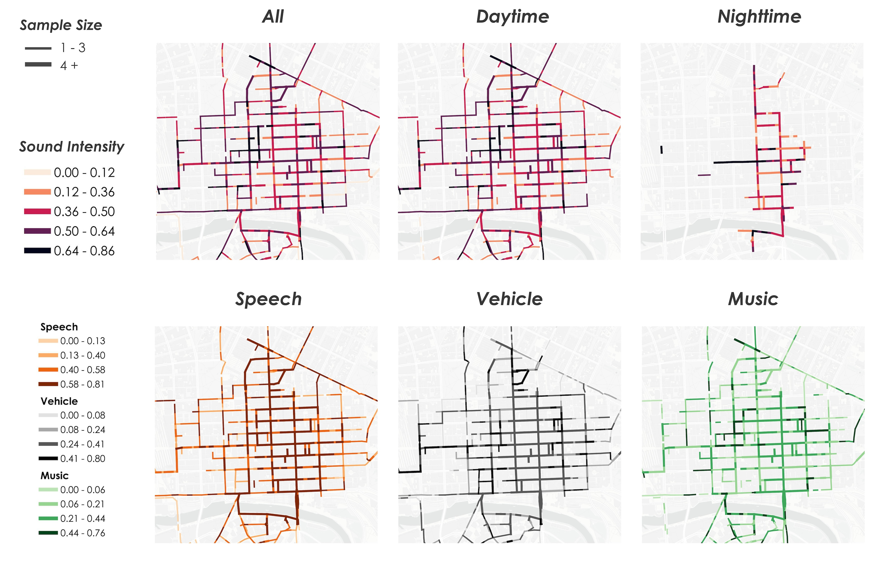

We introduce Street View Video (SVV), a new frontier for urban sensing. Using 892 geolocatable Melbourne videos spanning 542+ hours, we develop a reproducible pipeline from video to human activity and sound, revealing SVV’s potential to capture urban vitality dynamically and at scale.

<figure style="text-align: center;">
  <video
    controls
    playsinline
    preload="metadata"
    poster="/assets/video/SVV_CEUS_poster.jpg"
    style="width: 80%; max-width: 900px; height: auto; border-radius: 4px;">
    <source src="/assets/video/SVV_CEUS_stream.mp4" type="video/mp4">
    
Your browser does not support HTML5 video.
       <a href="/assets/video/SVV_CEUS_stream.mp4">Download the video</a> instead.

  </video>
  <figcaption style="font-size: 0.85em; color: #666; margin-top: 0.5em;">
    A video summarising the key workflow and methods used in this study.
  </figcaption>
</figure>

#### Highlights

- Street View Video (SVV) potentially offers a novel instrument for urban sensing.
- Development of an automated SVV-based geo-localization technique.
- Multimodal visual–auditory analysis effectively measures urban vitality.
- Human actions, sound, and temporal dimensions are frequently neglected yet essential.
- Insights from SVV inform planning for more vibrant and livable cities.

<figure style="text-align: center;">
  
  <figcaption style="font-size: 0.85em; color: #666;">
    A framework for data downloading, geo-locating, visual-auditory assessing, and spatial-temporal analyzing based on city tour videos.
  </figcaption>
</figure>

<figure style="text-align: center;">
  
  <figcaption style="font-size: 0.85em; color: #666;">
    Example workflow from a single street view video, illustrating three stages: (1) feature extraction of textual and depth information for localization and observer position estimation, (2) map matching to align estimated observers with the street network, and (3) visual–auditory assessment integrating pedestrian activity and sound environment analysis. Video frames © respective YouTube video creators.
  </figcaption>
</figure>

<figure style="text-align: center;">
  
  <figcaption style="font-size: 0.85em; color: #666;">
    Spatial distribution of pedestrian counts across all, daytime, and nighttime SVV samples, as well as counts for walking, standing, and sitting activities.
  </figcaption>
</figure>

<figure style="text-align: center;">
  
  <figcaption style="font-size: 0.85em; color: #666;">
    Spatial distribution of sound intensity across all, daytime, and nighttime SVV samples, as well as probability for sound types speech, vehicle, and music.
  </figcaption>
</figure>

#### Abstract
Urban vitality is a key quality of the livability and attractiveness of a city, with street-level social dynamics recognized as a central representation. However, existing approaches to capturing such dynamics, primarily through pedestrian volume, rely on static imagery, location-based proxies, or custom sensors. Such methods are typically discontinuous, limited in spatio-temporal resolution, costly, and overlook the role of sound in shaping environments. To address these gaps, this study explores the feasibility of using Street View Video (SVV), a novel, promising, yet under-utilized data source, for capturing street-level dynamics. Leveraging widely available crowdsourced city tour videos as a representative form of SVV, we develop an automated and scalable framework for high-precision geo-localization of SVV by extracting textual and depth information. Further, we propose a visual-auditory pipeline that integrates continuous pedestrian activity and sound environments as complementary dimensions that reveal street-level social dynamics. Using Melbourne as a case study, we identified 892 high-quality and geolocatable videos totaling over 541 hours and achieved an accuracy of 77\% for geo-localization. We generated spatio-temporal maps that not only reproduced well-studied pedestrian volume patterns, but also previously neglected aspects, including human actions (walking, standing, sitting), sound intensity, and sound types (speech, music, vehicle). Correlation and quadrant analyses further explored the relationships among these vitality dimensions, revealing distinctive street characteristics and highlighting the limitations of conventional road classifications. Overall, these findings demonstrate the potential of SVV as a multimodal and reproducible source of urban vitality indicators, providing a proof-of-concept for future urban sensing applications.

#### Paper
Please check the paper [here](https://www.sciencedirect.com/science/article/pii/S0198971526001110).