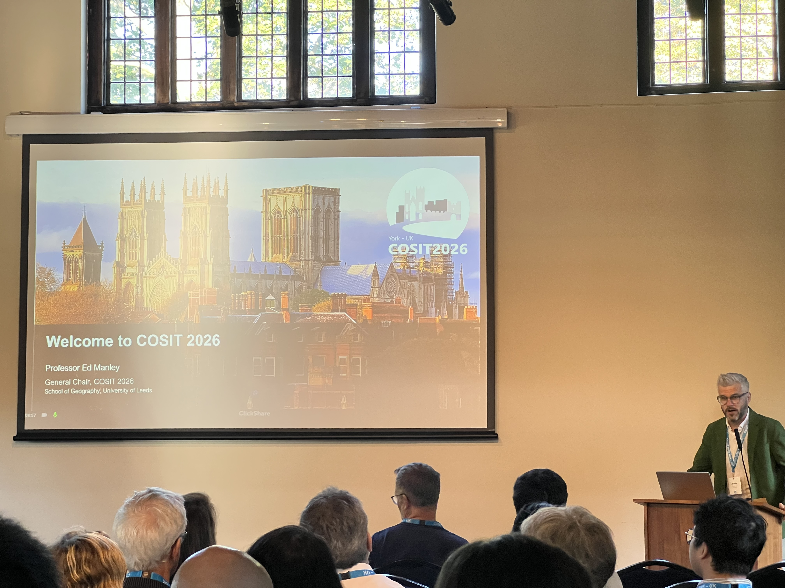
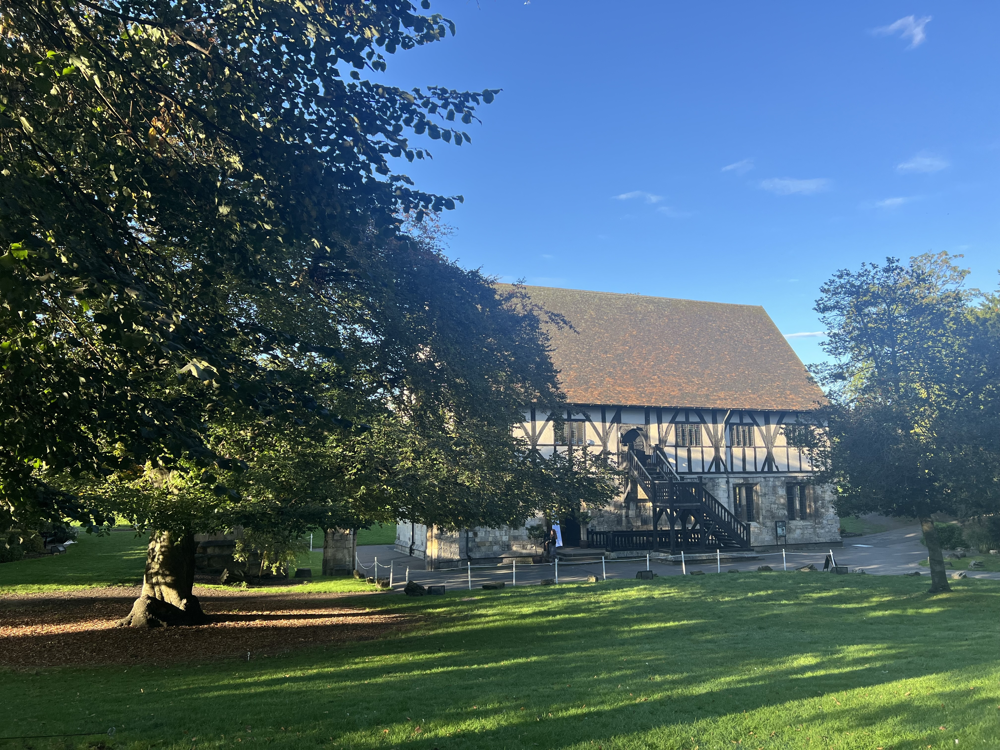
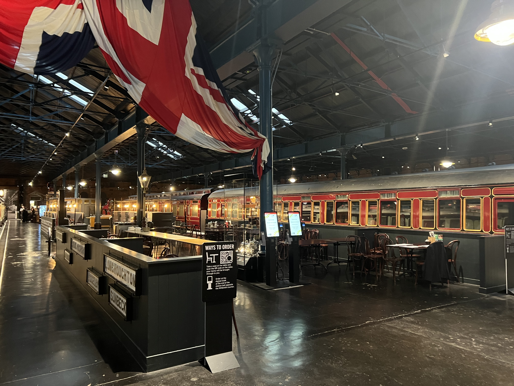
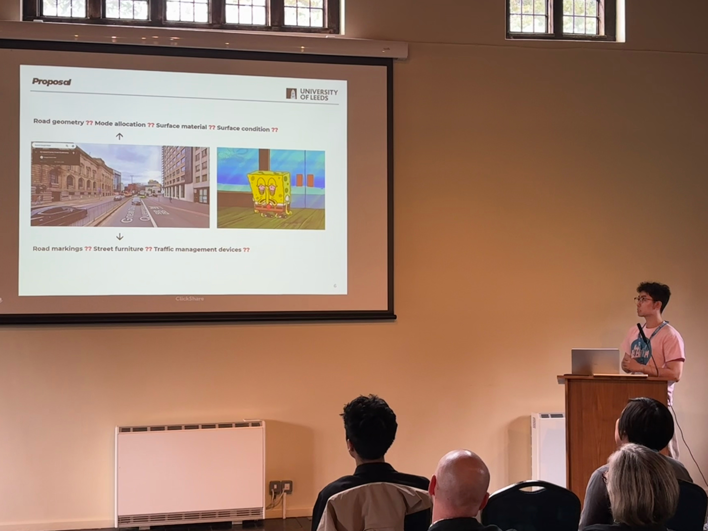
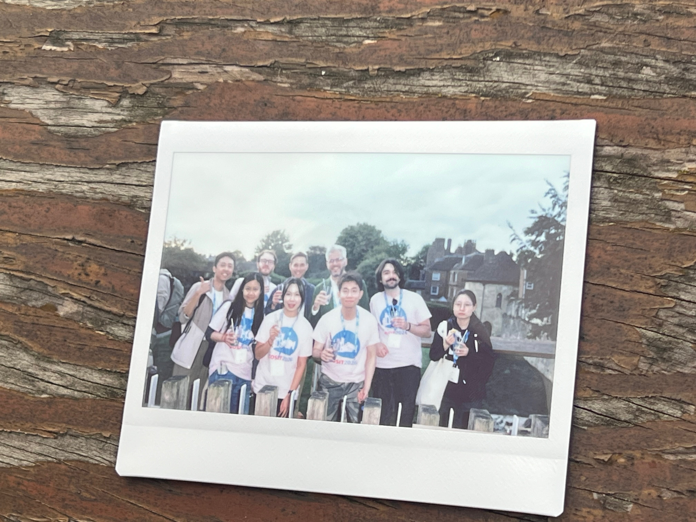

It was a pleasant and memorable experience last week -- I attended my very first COSIT 2026 conference in York, and it exceeded my expectations!

<figure style="text-align: center;">
  
  <figcaption style="font-size: 0.85em; color: #666;">
    Opening session led by Prof. Ed Manley.
  </figcaption>
</figure>

From insightful academic talks and stimulating discussions, to social events on the rooftop of York Museum, a walking tour along the York City Walls, and a banquet at the National Railway Museum, every part contributed to an inspiring and unforgettable experience. More importantly, it also gave me opportunities to reflect on my own research and the areas I still have to explore in my GIS journey.

<figure style="text-align: center;">
  
  <figcaption style="font-size: 0.85em; color: #666;">
    Beautiful conference venue in York Museum Gardens.
  </figcaption>
</figure>

<figure style="text-align: center;">
  
  <figcaption style="font-size: 0.85em; color: #666;">
    Banquet at the National Railway Museum.
  </figcaption>
</figure>

A big thank you to all the speakers for sharing their insightful work, to my supervisor, Ed Manley, for chairing the conference, and to the local organising committee and Mobility Science Lab members for putting together and supporting such a great programme.

I also had the opportunity to take part in the Doctoral Mentoring Programme, so a special thank you to my mentor, Asya Natapov, for the lovely conversation along the River Ouse, as well as to everyone who shared comments during my presentation.

Already looking forward to the next COSIT!

<figure style="text-align: center;">
  
  <figcaption style="font-size: 0.85em; color: #666;">
    Presenting my doctoral proposal during the Doctoral Mentoring Programme.
  </figcaption>
</figure>

<figure style="text-align: center;">
  
  <figcaption style="font-size: 0.85em; color: #666;">
    Group photo of Mobility Science Lab members.
  </figcaption>
</figure>